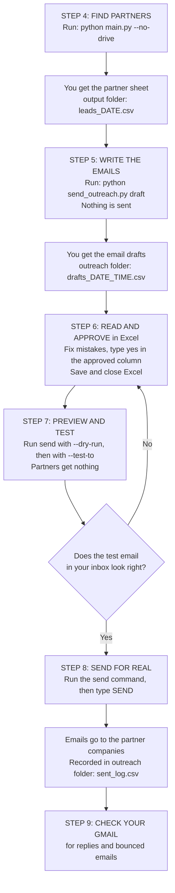

# Waresport Partnership Finder

Finds partnership leads for [Waresport](https://www.waresport.com) (sports club management software) and reaches out to them.

1. **Finds** Waresport's competitors.
2. **Collects** each competitor's partners and integrations, with a contact email for every partner, and saves them as a CSV and a Google Sheet.
3. **Drafts and sends** a researched, personalized partnership email to each partner, after a human approves it.

It runs locally on your machine, and everything is scheduled to run twice a week.(any day of week)

## Sales team quick start (no coding needed)

This section is for sales agents. Do **Steps 1 to 3 once** on your own computer. After that, only repeat **Steps 4 to 9**. You only change **one file** (called `.env`). You never edit the code.

**Your checklist. Change all of these before you send anything:**
- [ ] Your name (instead of the previous agent's): `OUTREACH_SENDER_NAME`
- [ ] Your job title: `OUTREACH_SENDER_TITLE`
- [ ] Your Gmail address: `OUTREACH_FROM_EMAIL`
- [ ] Your Gmail App Password: `SMTP_PASSWORD`
- [ ] The company postal address: `OUTREACH_MAILING_ADDRESS`
- [ ] The OpenAI key: `OPENAI_API_KEY`
- [ ] The Firecrawl key: `FIRECRAWL_API_KEY`

Steps 2 and 3 show you how to fill in each one.

> **Why this matters:** the emails go out under *your* name from *your* Gmail. If you skip a step, the emails could go out with the wrong name or address, or not send at all.

### Step 1. Install the tools (one time)
1. Install **Python** (version 3.10 or newer) from python.org. On the first install screen, tick **"Add python.exe to PATH"**.
2. Download this project (green **Code** button on GitHub, then **Download ZIP**, then unzip it), or ask your technical teammate to do it.
3. Open the unzipped folder. Click the address bar at the top of the window, type `powershell`, and press Enter. A blue window opens.
4. Type this and press Enter (wait for it to finish):
   ```
   pip install -r requirements.txt
   ```

### Step 2. Create your `.env` file (the one file you change)
1. In the project folder, find the file named **`.env.example`**.
2. Make a copy of it and rename the copy to exactly **`.env`** (a dot, then `env`, nothing else).
3. Open `.env` in Notepad and fill in the values below. **Everything after the `=` sign is yours to replace.** Do not put a space right after the `=`, and do not add quotes. Save the file when you are done.

> **Windows tip:** if Notepad saves it as `.env.txt`, the tool will not find it. Choose **Save as type: All files** and name it `.env`.

| Line in `.env` | What to put there | Where you get it |
|---|---|---|
| `OPENAI_API_KEY=` | The key that lets the tool research and write emails. Starts with `sk-` | Ask your manager, or create one at platform.openai.com > API keys |
| `FIRECRAWL_API_KEY=` | The key that lets the tool read websites. Starts with `fc-` | Ask your manager, or create one at firecrawl.dev > API keys |
| `OUTREACH_SENDER_NAME=` | **Your own full name.** This is the name signed on every email | You (for example `Priya Patel`) |
| `OUTREACH_SENDER_TITLE=` | **Your own job title** | You (for example `Partnerships Manager`) |
| `OUTREACH_FROM_EMAIL=` | **The Gmail address you send from.** Replies come back here | Your Gmail address |
| `SMTP_PASSWORD=` | **A special 16-letter Gmail "App Password"**. It is NOT your normal Gmail password (see below) | Your Google account |
| `OUTREACH_MAILING_ADDRESS=` | Waresport's real postal address. It is printed at the bottom of every email (the law requires it) | Ask your manager. **Replace the example text**, or it will be printed in your emails |
| `GOOGLE_DRIVE_FOLDER_ID=` | Leave **empty** unless your manager set up Google Drive for you | Optional |

When you are done, those lines should look like this (with your own details):
```
OUTREACH_SENDER_NAME=Priya Patel
OUTREACH_SENDER_TITLE=Partnerships Manager
OUTREACH_FROM_EMAIL=priya@example.com
```
**Do not leave any example text behind** (such as `Your Name` or `you@example.com`). The tool cannot tell it is an example, and would use it in a real email.

### Step 3. Get your Gmail App Password (about 3 minutes)
Google does not let programs use your normal password, so you create a separate 16-letter one.
1. Go to **myaccount.google.com**, then **Security**.
2. Sign in with the **same Gmail address** you put in `OUTREACH_FROM_EMAIL`. Turn on **2-Step Verification** if it is not already on.
3. Search for **App passwords**, create one (name it `Waresport`), and copy the 16 letters Google shows you.
4. In the blue window, type `python send_outreach.py setup` and press Enter. Paste the 16 letters (you will not see them as you type) and press Enter. It saves them into `.env` for you.

### The whole process in one picture

Once Steps 1 to 3 are done, this is what you do each time:



**Only two files are ever run:**

| File | What it does | Does it send emails? |
|---|---|---|
| `main.py` | Finds partner companies and makes the Excel sheet | **No, never** |
| `send_outreach.py` | `draft` writes the emails. `send` sends the ones you approved | **Only with `send`**, and only after you type `SEND` |

Making the Excel sheet does **not** send any emails. Sending is always a separate step that you start yourself.

### Before each session: open the terminal
1. Open the project folder (the one with `main.py` in it).
2. Click the address bar at the top of the window, type `powershell`, and press Enter.
3. Paste one command at a time, press Enter, and wait until it finishes.

### Step 4. Find partners and make the Excel sheet
```powershell
python main.py --no-drive
```
- **Wait for it to finish.** It can take a long time. The sheet is only saved at the very end, so do not close the window.
- **It is done when you see:** `Wrote ... rows to output\leads_DATE.csv`
- **To open the sheet**, go to the `output` folder and double-click the newest `leads_` file.

Running it twice on the same day replaces that day's sheet, so rename the first one if you want to keep it. For a quick trial run, use:
```powershell
python main.py --no-drive --max-competitors 2 --max-per-competitor 4
```

### Step 5. Write the emails (nothing is sent)
```powershell
python send_outreach.py draft
```
- It uses your **newest** `leads_` sheet and writes up to 25 emails.
- **It is done when you see:** `wrote ... drafts ... to ...drafts_DATE_TIME.csv`
- Your drafts are in the `outreach` folder. **Write down the file name**, for example `drafts_2026-11-25_0930.csv`. You need it in Steps 7 and 8.

To use a different sheet, put its name in the command:
```powershell
python send_outreach.py draft --input output/leads_2026-11-25.csv
```

### Step 6. Read and approve the emails
1. Open the `outreach` folder and double-click your `drafts_` file. It opens in Excel.
2. Look at these columns:

| Column | What to do |
|---|---|
| `to_email` | Check the address looks right. Delete any address you do not want |
| `subject` and `body` | Read every word. Fix anything wrong or untrue, such as "recent" news that is old |
| `status` | Only rows that say `draft` can be sent. Leave the others alone |
| `approved` | Type **`yes`** to send this email. **Leave it empty** to not send it |

3. **Save** the file (Ctrl + S). If Excel asks for a file type, choose **CSV UTF-8**. Then **close Excel**.

**To email just one company,** type `yes` on that row only.

### Step 7. Preview and test (partners get nothing)
> In the commands below, replace `drafts_2026-11-25_0930.csv` with **your** file name. Shortcut: type `outreach\drafts_` and press **Tab** to fill in the name (press Tab again for the next file).

**7a. Preview on screen.** Nothing is sent:
```powershell
python send_outreach.py send --drafts outreach/drafts_2026-11-25_0930.csv --dry-run
```
**7b. Send the approved emails to yourself.** Replace `you@example.com` with your own email:
```powershell
python send_outreach.py send --drafts outreach/drafts_2026-11-25_0930.csv --test-to you@example.com
```
Open your inbox and check the subject, your name, your job title and the address at the bottom. If something is wrong, go back to Step 6 (or fix `.env` if it is your name, title or address).

The preview and the test can still show companies you have already emailed. The real send in Step 8 skips them.

### Step 8. Send to the real partner companies
> **Stop and check:** this command sends real emails, and they cannot be taken back.

```powershell
python send_outreach.py send --drafts outreach/drafts_2026-11-25_0930.csv
```
- It tells you how many emails will go out. Type **`SEND`** (capital letters) and press Enter. Anything else cancels.
- It waits about 45 seconds between emails, so 25 emails take around 20 minutes. Do not close the window.
- **It is done when you see:** `done: ... of ... sent`

### Step 9. After sending
1. Check your Gmail inbox for **replies**, and for **bounced** emails (a message saying the address was not found).
2. If someone says "no thanks", open `outreach/suppression.txt` in Notepad (create it if it is not there) and add their email address on a new line.

### All the commands on one page

| Step | Command | Sends to partners? |
|---|---|---|
| 4. Find partners | `python main.py --no-drive` | No |
| 5. Write emails | `python send_outreach.py draft` | No |
| 6. Approve | Open the drafts file in Excel and type `yes` | No |
| 7a. Preview | `python send_outreach.py send --drafts outreach/YOUR-FILE.csv --dry-run` | No |
| 7b. Test on yourself | `python send_outreach.py send --drafts outreach/YOUR-FILE.csv --test-to YOUR-EMAIL` | No |
| **8. Real send** | `python send_outreach.py send --drafts outreach/YOUR-FILE.csv` | **Yes** |

### Rules the tool follows for you
- Every email subject includes the word **Waresport**.
- It sends **at most 25 emails a day**, with a pause between each, so Gmail does not block you.
- It can write to **up to 3 addresses** at one company. Delete any address you do not want from the `to_email` column in the drafts file.
- Once a company has been emailed, **later runs skip it**. The record is in `outreach/sent_log.csv`, on **your computer only**. Before your first send, ask teammates for their `sent_log.csv` and put it in your `outreach` folder. If you already have one, add their rows to yours. Do not replace it, or the tool forgets who you emailed.
- If someone replies "no thanks", add their email address (or company website) as a new line in `outreach/suppression.txt` so they are never contacted again.

### If something goes wrong
| What you see | What it means | What to do |
|---|---|---|
| `can't send -- set these in .env first: ...` | Something in Step 2 is empty | Fill in the lines it names |
| `login failed ... use an App Password` | The Gmail password is wrong | Redo Step 3. It must be the 16-letter App Password |
| `OpenAI isn't configured` | `OPENAI_API_KEY` is missing or wrong | Check that line in `.env` |
| Emails are signed with another person's name | `OUTREACH_SENDER_NAME` was not changed | Fix it in `.env`, save it, then write the drafts again |
| `No leads CSV found` | There is no partner sheet yet | Do Step 4 first, or give the sheet name with `--input` |
| `Drafts file not found` | The drafts file name is wrong | Check the name in the `outreach` folder. Use the Tab shortcut in Step 7 |
| `no approved drafts to send` | No row has `yes` in `approved`, or the file was not saved | Do Step 6 again, then save and close Excel |
| `nothing left to send` | Those companies were already emailed, or are on the do-not-contact list | Nothing to fix. Draft emails for other companies |
| `today's cap ... is already used up` | You reached 25 emails today | Try again tomorrow |
| `'python' is not recognized` | Python is not installed correctly | Reinstall it and tick **"Add python.exe to PATH"** |

**Keep your `.env` private.** It holds your passwords. Never email it, upload it to GitHub, or paste its contents into a chat. If you ever do, replace the keys straight away.

## How it works

| Stage | Command | What happens |
|---|---|---|
| 1. Find leads | `python main.py` | Competitors are discovered, their partner/integration pages are scraped, partners are de-duplicated across competitors, emails are looked up, and a CSV (plus a Google Sheet copy) is produced. Aims for 10 competitors that each have at least one new partner. |
| 2. Schedule | `schedule_task.ps1` | A Windows scheduled task runs stage 1 every Monday and Thursday at 8 AM Pacific. |
| 3. Outreach | `python send_outreach.py` | Reads the sheet, researches each partner, drafts a fact-checked email, waits for your approval, then sends through Gmail. |

## Services used, and for what

| Service | Used for | Cost / key |
|---|---|---|
| **OpenAI** (`gpt-4o-mini`) | Naming competitors; choosing the right website from search results; extracting partner names from messy pages; finding emails in page text; describing competitors; the partner research, analysis, email writing and fact-check | Paid per use. `OPENAI_API_KEY` |
| **DuckDuckGo** (`ddgs` package) | All web searches (competitor lists, websites, integration pages, news, contact snippets) | Free, no key |
| **Firecrawl** | Scraping pages a plain fetch can't read (JavaScript-rendered or blocked), including contact pages. Also a fallback if DuckDuckGo returns nothing. Calls are rate-limited and cached for 24h | Paid / free tier. `FIRECRAWL_API_KEY` |
| **Google Drive API** | Uploads each run's sheet to a Drive folder as a Google Sheet; reads the latest sheet for outreach | Free. Your own Google sign-in (see below) |
| **Gmail SMTP** | Sends the outreach emails | Free. Gmail App Password |
| *Gemini, Crawl4AI* | Optional comparison experiments only. Off by default | Not needed |

## Setup

**Requirements:** Python 3.10+.

```bash
git clone <this repo>
cd partnership-finder
pip install -r requirements.txt
```

`crawl4ai` and `google-genai` in `requirements.txt` are only for the optional experiments; you can remove them if you don't need those.

### 1. Keys: copy `.env.example` to `.env` and fill it in

| Key | Needed for | How to get it |
|---|---|---|
| `OPENAI_API_KEY` | **Required** | platform.openai.com > API keys |
| `FIRECRAWL_API_KEY` | Recommended (JS-heavy pages are skipped without it) | firecrawl.dev > API keys |
| `GOOGLE_DRIVE_FOLDER_ID` | Optional: Drive upload | Folder link or the ID at the end of its URL |
| `OUTREACH_SENDER_NAME`, `OUTREACH_SENDER_TITLE` | Sending emails | Your name and job title (signature) |
| `OUTREACH_FROM_EMAIL` | Sending emails | The Gmail address you send from |
| `OUTREACH_MAILING_ADDRESS` | Sending emails | A real postal address, printed in every email footer (required by US law) |
| `SMTP_PASSWORD` | Sending emails | Gmail **App Password** (16 characters), not your normal password. Google Account > Security > turn on 2-Step Verification > App passwords. Or run `python send_outreach.py setup` |
| `OUTREACH_REPLY_TO`, `SMTP_HOST`, `SMTP_PORT`, `SMTP_USER`, `OUTREACH_DAILY_CAP`, `OUTREACH_COMPANY`, `OUTREACH_COMPANY_WEBSITE` | Optional | Defaults: Gmail SMTP on 587, 25 sends/day, Waresport |

`GOOGLE_API_KEY` (Gemini) and `CRAWL4AI_API_KEY` are **not used** and are commented out in `.env.example`.

### 2. Google Drive upload (optional, one-time)

1. In [Google Cloud Console](https://console.cloud.google.com), create or pick a project and enable the **Google Drive API**.
2. Set up the **OAuth consent screen**. Choose *Internal* for a Workspace account. Otherwise choose *External*, add yourself as a test user, then click **Publish app** (apps left in "Testing" sign you out after 7 days).
3. **Credentials > Create credentials > OAuth client ID > Desktop app**. Download the JSON and save it as `secrets/google_oauth_client.json`.
4. Set `GOOGLE_DRIVE_FOLDER_ID` in `.env`, then run `python upload_to_drive.py --auth` once and approve access in the browser.

After that, every run uploads automatically. Skip it for one run with `--no-drive`.

## Usage

### Find leads
```bash
python main.py                       # full run: 10 competitors, partners, emails, CSV + Drive upload
python main.py --max-competitors 5   # quicker test run
python main.py --no-enrich           # skip email lookup (fast)
python main.py --no-drive            # don't upload to Drive
python main.py --seed CourtReserve   # make sure a competitor you care about is included
python main.py --out my_leads.csv
```
Other options: `--expand`, `--max-per-competitor`, `--delay`. See `python main.py --help`.

Output: `output/leads_<date>.csv` with the columns `competitor_name, competitor_website, competitor_description, partner_name, category, fit, description, website, website_confidence, contact_page, email_1-3, email_confidence, source_url, notes`.
`email_confidence` is `verified_found` (a real address from a page), `pattern_guess` (an `info@domain` guess, NOT verified) or `not_found`.

### Run it on a schedule (Windows)
```powershell
.\schedule_task.ps1            # Mondays and Thursdays, 8 AM Pacific (converted to your local time)
.\schedule_task.ps1 -Remove    # remove the schedule
```
The computer must be on. Re-run the script when daylight saving time changes. Logs go to `logs/`.

### Send outreach emails
```bash
python send_outreach.py draft --sheet            # draft from the newest Google Sheet in your Drive folder
python send_outreach.py draft --input output/leads_x.csv
#   open outreach/drafts_<time>.csv, edit if you like, put "yes" in the approved column
python send_outreach.py send --drafts outreach/drafts_<time>.csv --dry-run
python send_outreach.py send --drafts outreach/drafts_<time>.csv --test-to you@example.com
python send_outreach.py send --drafts outreach/drafts_<time>.csv          # real send, type SEND to confirm
```
**Always do the dry run and the `--test-to` send to your own inbox first.**

How drafting works (per partner):
1. **Pick addresses:** up to 3 trustworthy addresses per partner, each gets its own email. HR, support and press inboxes are kept (ranked last). Skipped, and printed with a reason: no email, unverified guessed addresses, broken or unrelated-domain addresses, duplicates, anyone already contacted, anyone in `outreach/suppression.txt`.
2. **Fit check:** clear non-partners (clubs, leagues, associations, competitors) are skipped as `not a fit`.
3. **Deep dive:** the brand's own pages and recent news are gathered; a fact sheet is built only from that evidence; the fit with Waresport is analyzed; a 150-200 word pitch is written (signed with `OUTREACH_SENDER_NAME` / `OUTREACH_SENDER_TITLE` from `.env`, and the subject must contain "Waresport"); a fact-check pass rejects unsupported claims (rewrite once, otherwise no draft).
4. **Review:** the drafts CSV shows the research summary, analysis and source URLs next to each email.
5. **Send:** through Gmail, about 45 seconds apart, at most 25 a day. The signature, postal address and opt-out line are added by code. Every send is logged in `outreach/sent_log.csv`, so nobody is emailed twice.

## What is customised for Waresport (change these to reuse it for another company)
- `finder/discovery.py`: `WARESPORT_DESCRIPTION` and the `Waresport alternatives competitors` search query.
- `finder/deep_dive.py`: `WARESPORT_FACTS`, the only Waresport facts the email writer may state. Keep it in line with the website.

## Project files

| File | What it does |
|---|---|
| `main.py` | Command-line entry point for stage 1 (finding leads) |
| `send_outreach.py` | Command-line entry point for outreach: `draft`, `send`, `setup` |
| `upload_to_drive.py` | Manual Google Drive sign-in (`--auth`) and upload of a CSV |
| `run_scheduled.ps1` | One scheduled run: runs `main.py` and writes a log |
| `schedule_task.ps1` | Creates or removes the Windows scheduled task (Mon/Thu 8 AM Pacific) |
| `requirements.txt` | Python dependencies |
| `.env.example` | Template listing every setting; copy to `.env` |
| `compare_gemini.py` | One-off script that compared Gemini and OpenAI competitor lists (not part of the pipeline) |
| `finder/pipeline.py` | Orchestrates a run: loops through competitors until the target is met, de-duplicates, enriches, exports the CSV, uploads to Drive |
| `finder/discovery.py` | Finds competitors and websites, finds integration pages, extracts partners, describes competitors |
| `finder/enrich.py` | Finds a contact email per partner (escalating methods, ending in a labeled guess) |
| `finder/models.py` | The `Partner` record, the company-domain helper and the cross-competitor duplicate key |
| `finder/search.py` | Web search: DuckDuckGo first, Firecrawl search as fallback |
| `finder/ddg_client.py` | DuckDuckGo wrapper (paced, retried) |
| `finder/page_fetch.py` | Fetches a page: free request first, Firecrawl only if needed; a plain 404 is never escalated |
| `finder/firecrawl_client.py` | The only gateway to Firecrawl: shared rate limit, retries with backoff, 24h cache |
| `finder/openai_client.py` | Every OpenAI call (extraction, picking, describing, competitor lists, email lookup) |
| `finder/deep_dive.py` | Research, analysis, email writing and fact-checking for outreach |
| `finder/outreach.py` | Outreach logic: address selection and rules, fit check, drafts file, Gmail sending, send log |
| `finder/gdrive.py` | Google Drive sign-in, upload as a Sheet, reading the latest Sheet |
| `finder/llm_select.py`, `finder/scrape_select.py` | Switches for the optional Gemini / Crawl4AI experiments; defaults to OpenAI / Firecrawl |
| `finder/gemini_client.py`, `finder/crawl4ai_client.py` | Optional experiment backends, off by default |
| `finder/courtreserve.py`, `finder/seeds.py` | First-version scrapers for CourtReserve and PodPlay; no longer used |
| `finder/__init__.py` | Marks `finder` as a Python package |

Folders created while running (all git-ignored): `output/` (CSVs), `outreach/` (drafts, sent log, suppression list, downloaded sheets), `logs/`, `secrets/` (Google sign-in files), `.cache/` (Firecrawl cache).

## Important notes
- **This is a starting point, not a verified list.** Extraction is LLM-driven and can be wrong. Check websites with `website_confidence` other than `llm_picked`, treat `pattern_guess` emails as guesses, and read each draft before approving it.
- **Cold email is regulated.** The tool adds a postal address and an easy opt-out (US CAN-SPAM). Recipients in Canada (CASL) and the EU/UK (GDPR) have stricter rules, so check before mailing them. Add anyone who says "no thanks" to `outreach/suppression.txt` (one email or domain per line).
- **Keep keys private.** `.env` and `secrets/` are git-ignored; never commit them. If a key is ever shared in chat or a screenshot, rotate it.
- A new Gmail sending address should start small (the default cap is 25 a day).
